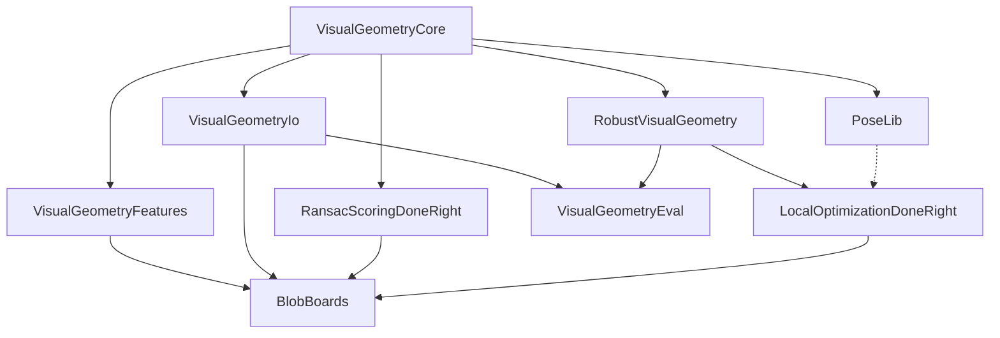

# Visual Geometry Toolkit

Composable Julia packages for robust multiple-view geometry: geometric types
and camera models, file formats, feature detection, robust estimation and
RANSAC, evaluation protocols, and a PoseLib wrapper, factored so each layer is
usable on its own.

by [James Pritts](https://prittjam.github.io/)

Documentation for every package: <https://visualgeometrytoolkit.github.io>

## Packages

In the [VisualGeometryToolkit.jl](https://github.com/VisualGeometryToolkit/VisualGeometryToolkit.jl) monorepo:

| Package | Role |
|---|---|
| [VisualGeometryCore](https://github.com/VisualGeometryToolkit/VisualGeometryToolkit.jl/tree/main/VisualGeometryCore) | Geometric types, frames, camera and lens models, minimal solvers, scale-space kernels, the robust-estimation contracts |
| [VisualGeometryIo](https://github.com/VisualGeometryToolkit/VisualGeometryToolkit.jl/tree/main/VisualGeometryIo) | Versioned file formats: cameras, rigs, observations, targets, correspondences |
| [VisualGeometryFeatures](https://github.com/VisualGeometryToolkit/VisualGeometryToolkit.jl/tree/main/VisualGeometryFeatures) | Feature detection (ASIFT/DoG with keypoint covariance) and matching |
| [RobustVisualGeometry](https://github.com/VisualGeometryToolkit/VisualGeometryToolkit.jl/tree/main/RobustVisualGeometry) | The RANSAC loop, problem implementations, IRLS, hand–eye calibration |
| [VisualGeometryEval](https://github.com/VisualGeometryToolkit/VisualGeometryToolkit.jl/tree/main/VisualGeometryEval) | Evaluation protocol, benchmark pools, tuning, reproducible paper projects |
| [PoseLib](https://github.com/VisualGeometryToolkit/VisualGeometryToolkit.jl/tree/main/PoseLib) | Julia wrapper of the PoseLib minimal solvers (prebuilt binaries as package artifacts) |

In their own repositories:

| Package | Role |
|---|---|
| [RansacScoringDoneRight.jl](https://github.com/VisualGeometryToolkit/RansacScoringDoneRight.jl) | Scale-free marginal RANSAC scoring |
| [LocalOptimizationDoneRight.jl](https://github.com/VisualGeometryToolkit/LocalOptimizationDoneRight.jl) | Local optimization for RANSAC |
| [BlobBoards.jl](https://github.com/VisualGeometryToolkit/BlobBoards.jl) | Fiducial blob-board targets |

## Package stack

Each package builds on the ones above it (direct dependencies; edges implied through another package are omitted). Dashed: optional (package extension).
